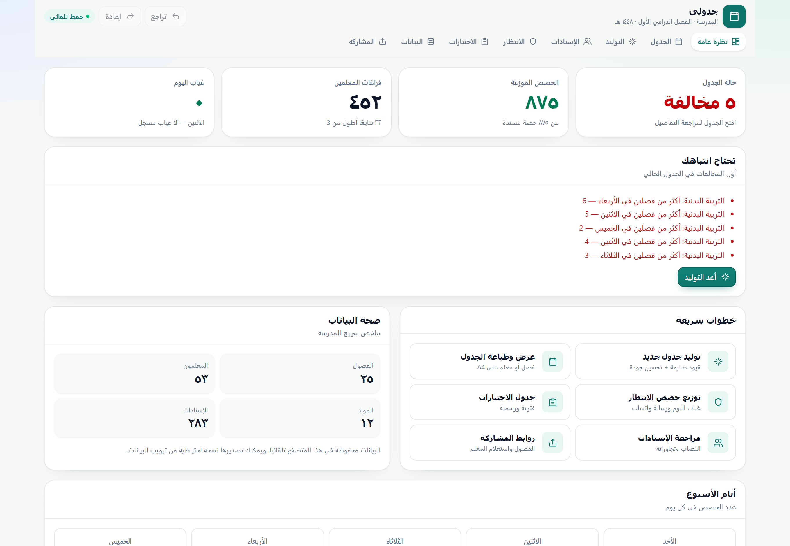
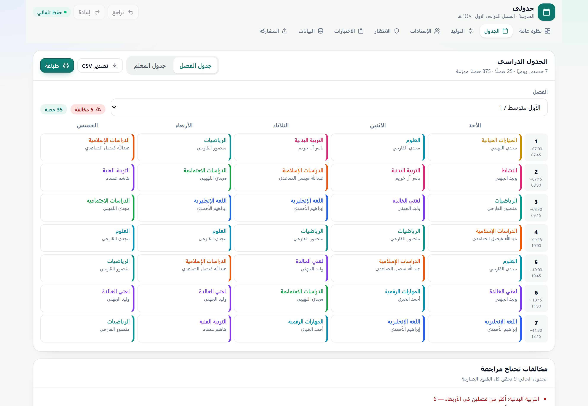
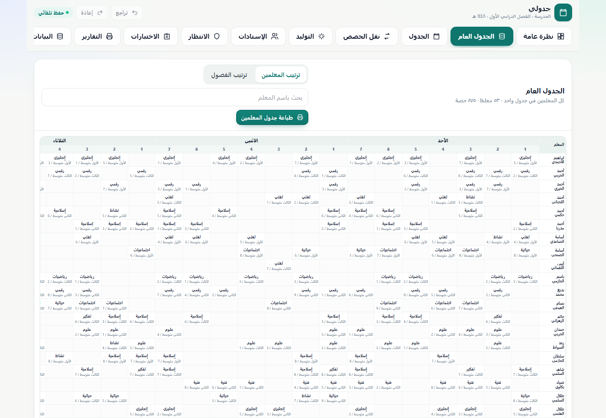
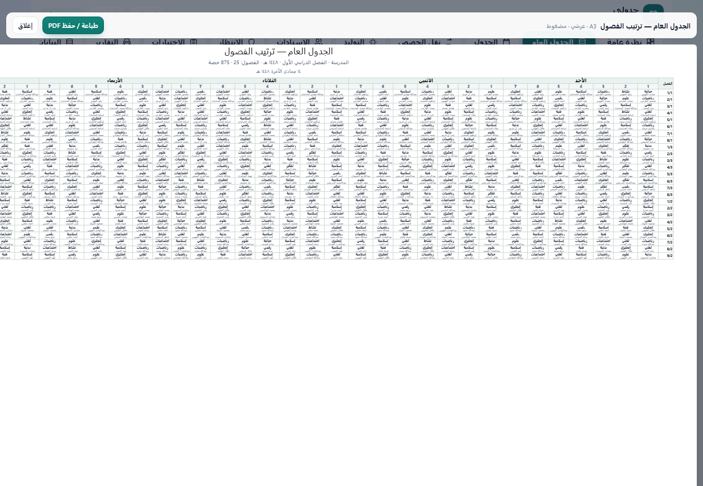
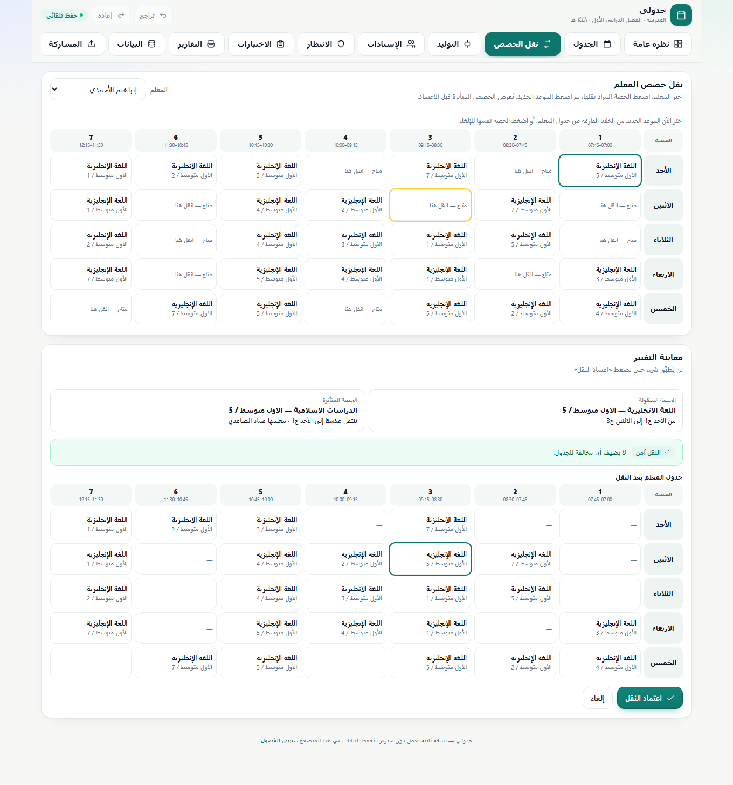
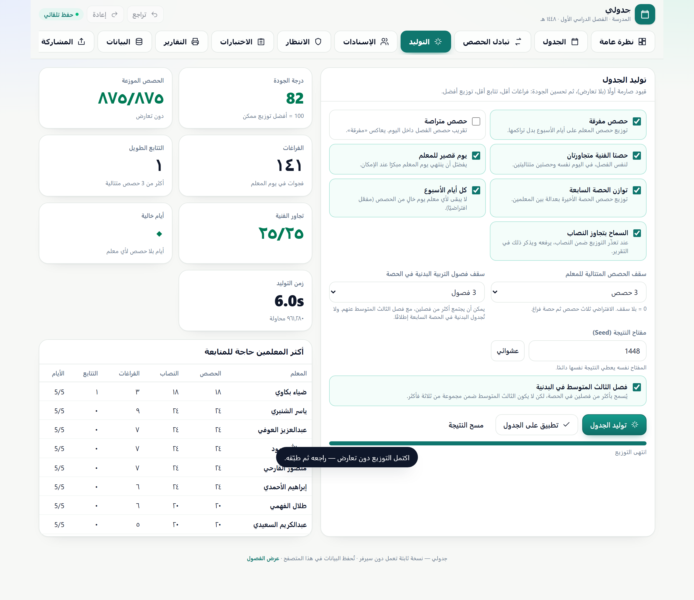
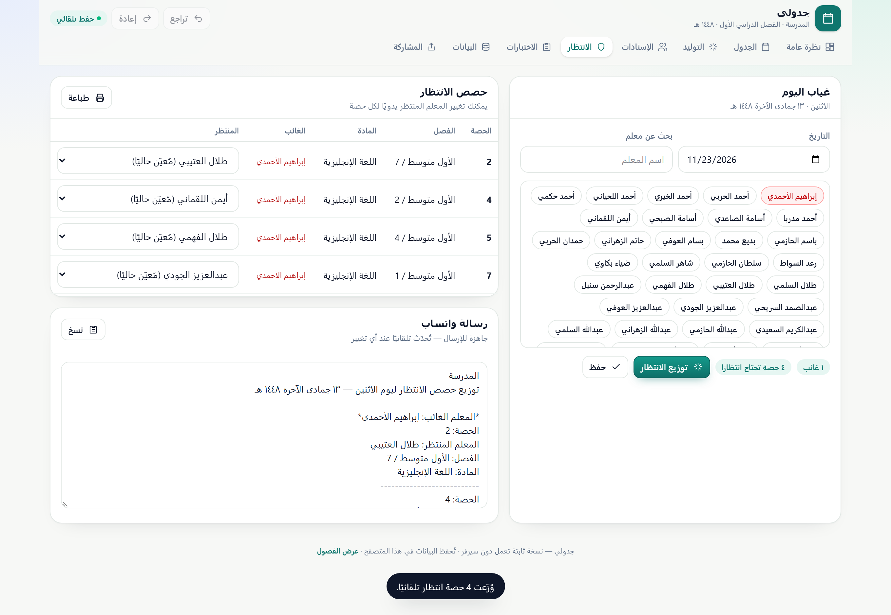
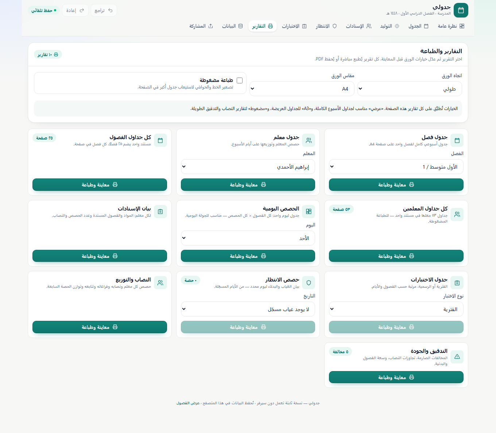
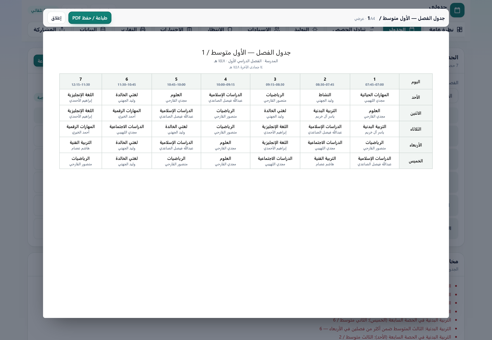
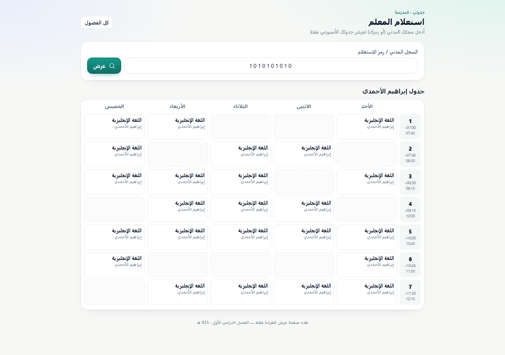

# جدولي — برنامج الجداول المدرسية

تطبيق عربي (RTL) كامل لإدارة الجدول المدرسي: توليد ذكي للجدول، توزيع حصص الانتظار، جدول الاختبارات، الإسنادات، والطباعة — **بلا سيرفر ولا تسجيل دخول**، يعمل في المتصفح ويُحفظ محليًا.

**جرّبه الآن:** https://hasss5g-cpu.github.io/jadwali/

النسخة الأولى مبنية على بيانات مدرسة حقيقية: **25 فصلًا، 53 معلمًا، 12 مادة، 283 إسنادًا، 875 حصة**.



## ما الذي يجعله أفضل؟

| | النسخة السابقة | جدولي الجديد |
|---|---|---|
| التشغيل | سيرفر Next.js على Cloudflare + قاعدة D1 + تسجيل دخول | ملفات ثابتة، تفتح فورًا وتعمل دون اتصال |
| النشر | أداة Sites داخل Codex فقط | GitHub Pages آليًا مع كل دفعة |
| التوزيع | 452 فراغًا، 5 تتابعات طويلة، و5 حصص بدنية ثلاثية تضم الثالث المتوسط في البيانات المسلّمة | **0 تعارض، 25/25 تجاور فنية، ~139 فراغًا، 0–1 تتابع طويل، درجة ~83، وكل معلم يعمل 5/5 أيام** |
| الشفافية | التقرير نصي داخل التطبيق | تقرير قابل للقياس لكل معلم + مفتاح نتيجة (Seed) قابل للتكرار |
| الخصوصية | روابط بسيرفر ورموز | رموز المعلمين محفوظة كبصمة **SHA-256** فقط |
| التراجع | حفظ فقط | تراجع/إعادة (40 خطوة) + حفظ تلقائي + تصدير/استيراد JSON |

## المزايا

- **توليد الجدول**: قيود صارمة (تعارض المعلم، يوم الراحة، قيود البدنية) ثم تحسين جودة (فراغات أقل، سقف 3 حصص متتالية، تجاور حصتي الفنية، توازن الحصة السابعة، انتهاء اليوم مبكرًا، وتوزيع أو تراصّ الحصص). **افتراضيًا يعمل كل معلم في أيام الأسبوع الخمسة بلا يوم خالٍ** (يمكن إيقاف الخيار).
- **قيود البدنية قابلة للضبط**: سقف فصول في الحصة (٣ افتراضيًا) مع منع وجود الثالث المتوسط ضمن مجموعة من ثلاثة فأكثر، و**لا تُجدول التربية البدنية في الحصة السابعة إطلاقًا**.
- **نقل الحصص**: اعرض جدول المعلم، اضغط الحصة ثم الموعد الجديد؛ يعرض النظام الحصة المنقولة والحصة المتأثرة والجدول بعد النقل، ويفحص التعارضات (تعارض المعلم، يوم الراحة، قيود البدنية) قبل التطبيق — لا يُطبَّق شيء حتى «اعتماد النقل».
- **محرك مستقل**: يعمل في Web Worker فلا تتجمد الواجهة، ويعرض تقدمًا حقيقيًا وتقريرًا قبل التطبيق.
- **الجدول العام**: جدول مصفوفي لكل المدرسة بخيارين — **ترتيب المعلمين** (صف لكل معلم) أو **ترتيب الفصول** (صف لكل فصل) — مع بحث بالاسم. كل جدول يُضغط تلقائيًا إلى **صفحة واحدة**: المعلمون على A3 طولية، والفصول على A3 عرضية، بهوامش ٤مم وخط مصغّر ليتسع كامل الجدول.
- **جدول الفصل والمعلم**: عرض أسبوعي ملوّن، توقيت الحصص، تصدير CSV، وطباعة A4.
- **الانتظار والغطاء**: تحديد الغائبين، توزيع بدلاء تلقائي مع مراعاة التخصص والنصاب، تعديل يدوي، رسالة واتساب جاهزة، وطباعة بيان الانتظار.
- **الاختبارات**: توليد جدول الفترية (كل المواد) والرسمية (المواد الأساسية) بحد اختبارين يوميًا وبلا تعارض إشراف.
- **الإسنادات**: مراجعة نصاب كل معلم وتجاوزاته، وتعديل الأعداد مباشرة.
- **التقارير**: ١٠ تقارير جاهزة للطباعة — جدول فصل، جدول معلم، كل الفصول، كل المعلمين، الحصص اليومية، الإسنادات، الاختبارات (فترية/رسمية)، حصص الانتظار، النصاب والتوزيع، والتدقيق والجودة — مع خيارات ورق: A4/A3، طولي/عرضي، وطباعة مضغوطة.
- **البيانات**: تحرير المدرسة والمعلمين والفصول والمواد، استيراد/تصدير JSON، واستعادة النسخة الأصلية.
- **المشاركة**: رابط جداول الفصول للطلاب، ورابط استعلام المعلم برمز سري.











## التشغيل

```bash
pnpm install
pnpm dev        # http://localhost:5173
pnpm test       # اختبارات الوحدة
pnpm build      # مخرجات ثابتة في dist/
pnpm preview    # معاينة البناء
```

يتطلب Node.js 22+.

## كيف يعمل محرك التوزيع؟

1. **بناء أولي**: يُسند لكل فصل كل حصصه إلى مواعده (كل فصل ممتلئ 35/35 في بيانات المدرسة)، مع وضع حصتي الفنية متجاورتين أولًا.
2. **تبديلات داخل الفصل**: كل خطوة تبدّل حصتين في الفصل نفسه، فيبقى الجدول صالحًا ذاتيًا، وينحصر البحث في تعارضات المعلمين.
3. **تلدين محاكى**: عقوبات ثقيلة للقيود الصارمة (1000 لكل مخالفة) وعقوبات متدرجة للجودة، مع تبريد تدريجي حتى نهاية الميزانية الزمنية.
4. **استعادة الأفضل**: يُحتفظ بأفضل حل مرّ به البحث، لا بالحل الأخير.
5. **تقرير**: عدد الحصص، التعارضات، الفراغات، التتابع، تكرار المادة في اليوم، تجاور الفنية، ومقاييس كل معلم.

بميزانية 6 ثوانٍ على البيانات الحقيقية: **875/875 حصة، 0 تعارض، 25/25 تجاور فنية، وكل معلم يعمل في أيام الأسبوع الخمسة — درجة ~83** (قد يختلف التتابع الطويل بين 0 و1 حسب زمن التشغيل).

## البنية

```
src/
  types.ts              نموذج البيانات
  lib/
    model.ts            التحقق من القيود + أدوات العرض
    solver.ts           محرك التوزيع (تلدين محاكى)
    solver.worker.ts    تشغيل المحرك في الخلفية
    coverage.ts         البدلاء والرسائل
    exams.ts            توليد وفحص الاختبارات
    storage.ts          حفظ محلي + البيانات المضمنة
  views/                لوحات: نظرة عامة، الجدول، التوليد، الإسنادات، الانتظار، الاختبارات، البيانات، المشاركة
  components/           واجهات مشتركة + أوراق الطباعة
tests/                  اختبارات الوحدة (Vitest)
```

## النشر على GitHub Pages

**النسخة الحية:** https://hasss5g-cpu.github.io/jadwali/

البناء ثابت بالكامل (`base: './'`)، فيعمل على أي مسار. طريقة النشر الحالية تستخدم فرع `gh-pages` ولا تحتاج صلاحية `workflow`:

```bash
pnpm build
pnpm deploy:pages   # يدفع dist/ إلى فرع gh-pages
```

ثم من إعدادات المستودع: **Pages → Source: Deploy from a branch → gh-pages / (root)**.

لتشغيل النشر الآلي عبر GitHub Actions، امنح `gh` صلاحية سير العمل ثم انسخ الملف المرفق:

```bash
gh auth refresh -s workflow
mkdir -p .github/workflows && cp docs/deploy-workflow.example.yml .github/workflows/deploy.yml
git add .github/workflows/deploy.yml && git commit -m "ci: deploy" && git push
```

## الخصوصية

- لا يوجد سيرفر ولا إرسال بيانات.
- استعلام المعلم يعمل بالسجل المدني، لكنه يُحفظ كبصمة **SHA-256** فقط؛ لا يمكن استخراج السجل من الملف المنشور.
- صفحات المشاركة تقرأ بيانات المتصفح إن وُجدت، وإلا فالبيانات المضمّنة في `src/data/school.json`؛ بعد تعديل البيانات محليًا صدّرها وحدّث الملف وأعد النشر.

## الترخيص

MIT
